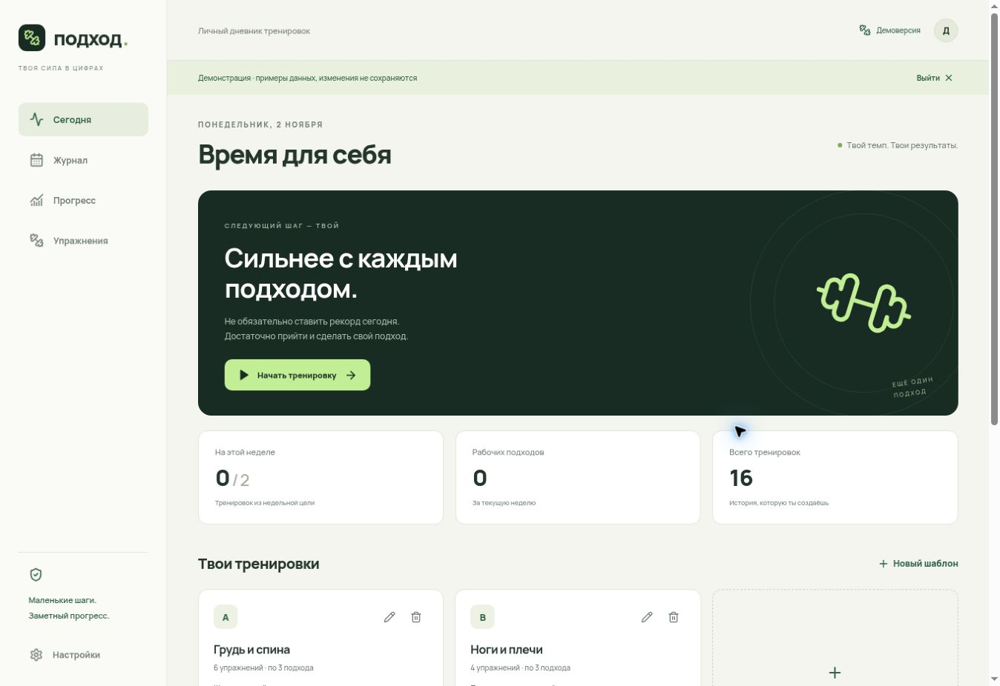

# Подход · gym-log

Личный дневник силовых тренировок: подходы, веса, повторения, объём и регулярность. Мобильное PWA на React + TypeScript, бесплатное размещение на Vercel и облачный журнал в Supabase.

**Статус: первая рабочая версия.** Код приложения, миграция базы и проверки готовы. Для личных записей необходимо один раз создать Supabase-проект и подключить его к Vercel. Без переменных окружения доступна только обозначенная демоверсия; она работает в памяти и не сохраняет изменения.



## Возможности

- Шаблоны тренировок: создание, изменение, удаление; два стартовых примера, которые можно заменить своим планом.
- Свободная тренировка, добавление упражнений, изменение порядка, копирование последнего подхода.
- Подстановка прошлых фактических весов/повторов как плана; новые подходы всегда неотмеченные.
- Рабочие и разминочные подходы, таймер отдыха, заметки, восстановление незавершённой тренировки.
- История с редактированием и фильтрами, календарь последних 14 дней.
- Графики веса при одинаковых повторах, повторений при одинаковом весе, тоннажа упражнения.
- Недельные цели с историей изменений, регулярность, рабочие подходы по основным мышцам.
- Каталог собственных упражнений, отдельные правила для штанги, пары гантелей, своего веса и противовеса.
- Вход/регистрация по email и паролю, восстановление пароля.
- Автосохранение на устройстве → синхронизация с облаком; явный статус отправки.
- Защита от перезаписи чужих изменений при одновременной работе с разных устройств. При конфликте предлагается скачать обе версии и выбрать одну; автоматического слияния пока нет.
- Экспорт JSON/CSV, восстановление JSON; опциональные автоматические зашифрованные копии через GitHub Actions.
- Установка на главный экран телефона, офлайн-загрузка после первого посещения, предложение обновить приложение после синхронизации.

## Быстрый запуск: Supabase → Vercel

### 1. Создать бесплатный Supabase-проект

1. Создай проект на https://supabase.com/dashboard и сохрани пароль базы у себя.
2. Открой **SQL Editor → New query**.
3. Скопируй и выполни весь файл [`supabase/migrations/202611020001_journal.sql`](supabase/migrations/202611020001_journal.sql).
4. В настройках проекта найди **Project URL** и клиентский **Publishable key** (либо legacy `anon` key). Названия разделов панели могут меняться.

Ключ `service_role` / secret key не нужен для приложения. Никогда не помещай его в `VITE_*`, исходники или публичные переменные. Доступ к данным защищён RLS: пользователю доступны только его записи. Запись выполняется через RPC, проверяющую владельца и версию документа.

### 2. Разместить на Vercel

1. Vercel → **Add New → Project → Import Git Repository** → `vlbelozerov/gym-log`.
2. Framework: **Vite**, build command: `npm run build`, output: `dist`.
3. Добавь переменные окружения для Production (и отдельно Preview, если нужны тестовые развёртывания):

   | Переменная               | Значение                            |
   | ------------------------ | ----------------------------------- |
   | `VITE_SUPABASE_URL`      | Project URL из Supabase             |
   | `VITE_SUPABASE_ANON_KEY` | Publishable key или legacy anon key |

4. Нажми **Deploy**. При изменении переменных нужен новый deployment, поскольку Vite включает их при сборке.

Vercel Hobby рассчитан на личное некоммерческое использование. Статические файлы и функции Vercel не заменяют базу: журнал находится в Supabase, не в GitHub и не на диске Vercel.

### 3. Настроить вход

1. Supabase → **Authentication → URL Configuration**.
2. Установи **Site URL** равным HTTPS-адресу приложения из Vercel.
3. Добавь этот же адрес в **Redirect URLs**. Для локальной разработки можно отдельно разрешить `http://localhost:5173`.
4. Включи Email provider. Зарегистрируйся в приложении и подтверди email, если подтверждение включено.
5. Для исключительно личного использования можно создать своего пользователя через Supabase Dashboard и затем отключить новые регистрации. Вход существующего пользователя продолжит работать.

У встроенной отправки писем Supabase есть ограничения. Если письмо подтверждения/сброса не приходит, проверь настройки Email/SMTP и журнал Auth. Не отключай защиту базы для решения проблем входа.

### 4. Проверить перед первым занятием

1. Войти, создать тренировку, отметить подход и дождаться **«Сохранено в облаке»**.
2. Открыть приложение в другом браузере, войти и проверить наличие записи.
3. В первом браузере отключить интернет, внести подход, вернуть связь и дождаться подтверждения сохранения.
4. После подтверждения можно очистить данные браузера и проверить восстановление после входа.

Без интернета новые изменения находятся только на устройстве. Очистка данных браузера до отправки удаляет такие изменения. При истечении сессии для восстановления синхронизации потребуется интернет. Приложение не отправляет Supabase-запросы через service worker и не кэширует облачные API-ответы в общем кэше.

На iPhone: Safari → Поделиться → На экран «Домой». На Android: меню браузера → Установить приложение. Фоновое исполнение/сигнал таймера не гарантируются браузером; после возврата остаток времени пересчитывается по абсолютной отметке.

## Автоматические резервные копии без ручного экспорта

Облачное сохранение работает автоматически после настройки выше. Бэкапы — отдельная защита от удаления/ошибки, они не включены автоматически в Supabase Free.

В репозитории подготовлен workflow [`backup.yml`](.github/workflows/backup.yml). Чтобы включить:

1. GitHub → Settings → Secrets and variables → Actions → **Secrets**:
   - `SUPABASE_URL` — адрес проекта.
   - `SUPABASE_SERVICE_ROLE_KEY` — серверный ключ Supabase **только для этого workflow**.
   - `BACKUP_ENCRYPTION_KEY` — случайные 32 байта в виде 64 hex-символов; сгенерировать локально: `openssl rand -hex 32`.
2. Сохрани ключ шифрования отдельно в менеджере паролей. Без него расшифровать копии нельзя.
3. В **Variables** добавь `ENABLE_BACKUPS=true`.
4. Actions → **Encrypted journal backup → Run workflow**. Убедись, что запуск успешен и создан artifact `encrypted-journals-…`.

Дальше workflow запускается ежедневно в 03:20 UTC (06:20 Москва), шифрует журнал AES-256-GCM и сохраняет только зашифрованный artifact на 90 дней. Открытых персональных данных в Git-коммитах и artifacts нет; plaintext не записывается на диск при создании копии. Размер и доступность artifacts зависят от квот GitHub. Копии не заменяют постоянный облачный журнал.

**Ограничение бесплатного варианта:** GitHub может задерживать schedule и отключает расписания в публичных репозиториях после 60 дней без активности репозитория. В таком случае расписание нужно повторно включить. Это автоматизация с обслуживанием, а не гарантированный вечный бэкап. Не создавай фиктивные коммиты/запросы ради обхода политик. Для варианта без этого ограничения нужен другой планировщик/сервис резервирования.

Supabase Free также может приостановить проект при низкой активности. Бэкап тогда завершится ошибкой; возобнови проект в Supabase Dashboard и повтори workflow. Настрой уведомления GitHub о неуспешных workflow.

Восстановление:

```bash
# BACKUP_ENCRYPTION_KEY передать через окружение, не добавлять в команду/файл репозитория.
node scripts/decrypt-backup.mjs journals.enc recovered.json
```

`recovered.json` содержит `journals`. Для одного пользователя возьми поле `journals[n].data`, сохрани как отдельный JSON и импортируй через настройки приложения. Перед импортом экспортируй текущую версию. Копия содержит документы тренировок, но не пароли, пользователей Auth и конфигурацию проекта. При восстановлении в новый Supabase-проект создай аккаунт заново и импортируй свой документ через приложение. Не загружай расшифрованные файлы в публичный репозиторий.

## Локальная разработка

Node.js 22+.

```bash
npm ci
cp .env.example .env.local
# Заполнить .env.local значениями своего тестового Supabase-проекта.
npm run dev
npm test
npm run build
```

Без заполненного `.env.local` открывается вход в демоверсию. Офлайн-кэш PWA проверяется на production-сборке через `npm run preview`, не в dev. Google Fonts — необязательное оформление; без сети используется системный шрифт.

## Архитектура и правила

- `src/model.ts` — типы, каталог, снимки упражнений, подстановка прошлых результатов.
- `src/metrics.ts` — рабочие подходы, тоннаж, неделя с понедельника, исторические цели.
- `src/sync.ts` — IndexedDB-очередь, последовательное сохранение, версии, повтор после потери ответа.
- `src/App.tsx` — вход, навигация, главный экран, журнал, настройки.
- `src/WorkoutEditor.tsx`, `Library.tsx`, `Progress.tsx` — основные сценарии.
- `supabase/migrations/` — база, RLS, атомарная RPC.
- `scripts/` — зашифрованное резервирование и расшифровка.

Для первого личного приложения состояние хранится как один JSON-документ на пользователя с номером ревизии. Это упрощает атомарное офлайн-сохранение и перенос данных. Максимум документа 8 МБ; фотографии/видео не хранятся. При дальнейшем росте можно перейти к отдельным таблицам тренировок. В одной вкладке изменения сериализованы; в браузерах с Web Locks вторая вкладка того же аккаунта ждёт закрытия первой. В старых браузерах без Web Locks используй одну вкладку.

Демо изолировано и не загружается в личный аккаунт. В новой личной записи есть каталог и примеры шаблонов, но нет выдуманной истории тренировок.

Тоннаж — сумма веса × повторений только выполненных рабочих подходов. Для пары гантелей вес одной умножается на два. Свой вес и противовес не входят в тоннаж; их прогресс сравнивается по дополнительному весу/помощи и повторениям. Общий тоннаж — справочный показатель, не универсальный балл силы. Учитывается одна основная мышечная группа упражнения; косвенная нагрузка не дублируется. Для другой техники/оборудования создавай отдельное упражнение.

В этой версии нет автоматического слияния конфликтов, расчёта 1RM, распознавания голоса, суперсетов, интеграции с часами и ИИ-рекомендаций.

## Проверки

`npm test` проверяет расчёты, независимость истории от каталога, валидацию импортов, офлайн-очередь, конфликт двух устройств, потерянное подтверждение сервера, изменения во время отправки и перезапуск приложения. SQL-миграция реально выполняется в PostgreSQL через PGlite; проверяются RLS, права, запрет анонимной записи и версии/idempotency RPC. GitHub Actions запускает эти тесты и production-сборку.

Для полного E2E входа, почты и живой синхронизации нужен настроенный Supabase-проект; локальные тесты не заменяют такую проверку.
